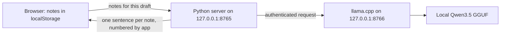

# Lantern Archive

A remembrance writer that helps you preserve the small details you remember about someone. You enter a person's name and up to eight real details. An open-weight model suggests a follow-up question to help you remember more, then rewrites each detail as one sentence. The app attaches each sentence's source number. You can edit, copy, or save the resulting text.

The app is intentionally modest: it does not impersonate the deceased or invent an afterlife conversation. It helps a living person shape a first draft from what they actually know.

Architecture: [High-Level Design](docs/HLD.md) · [Low-Level Design](docs/LLD.md)

An optional **hosted demo** runs the web app on Render Free and calls an open
model through DigitalOcean Serverless Inference. It has separate privacy
messaging and does not require downloading weights on Render. Follow the
[hosted deployment guide](docs/DEPLOYMENT.md); `render.yaml` contains the service
configuration. The offline instructions below continue to run inference on
your own computer.

[Deploy the hosted demo on Render](https://render.com/deploy?repo=https://github.com/Kingthnight/lantern-archive)

## Demo

Click **Try a fictional example** in the app. It fills in three invented notes about Mira, including a blue tin of orange peels. Click **Ask locally** for a question that might prompt another story. Click **Write a remembrance**. The draft should have one sentence and one citation for each note. Edit the draft directly, then copy it or save a text file. See [the short demo video](demo.webm), [the landing screenshot](demo-hero.png), and [the workspace screenshot](demo-workspace.png).

## Requirements

- Python 3.10 or newer (the app uses only the standard library)
- [llama.cpp](https://github.com/ggml-org/llama.cpp) with `llama-server` on your `PATH`
- A local GGUF model. Tested with [bartowski/Qwen_Qwen3.5-4B-GGUF](https://huggingface.co/bartowski/Qwen_Qwen3.5-4B-GGUF), file `Qwen_Qwen3.5-4B-Q4_K_M.gguf` (about 3 GB). The [original Qwen model](https://huggingface.co/Qwen/Qwen3.5-4B) and the conversion are Apache 2.0 licensed.
- An 8 GB or larger machine is recommended for this 4B quantization. It was tested on a 16 GB Windows laptop; actual use depends on your machine and context size.

On Windows, install llama.cpp with `winget install ggml.llamacpp`. On other systems, use the [llama.cpp installation guide](https://github.com/ggml-org/llama.cpp).

Download the model once while online. One way is:

```powershell
python -m pip install huggingface_hub
hf download bartowski/Qwen_Qwen3.5-4B-GGUF Qwen_Qwen3.5-4B-Q4_K_M.gguf --local-dir models
```

Then, from this folder:

```powershell
python app.py --model .\models\Qwen_Qwen3.5-4B-Q4_K_M.gguf
```

Open <http://127.0.0.1:8765>. The model is loaded on your computer. After the model and llama.cpp are installed, the app works without internet. Press Ctrl+C to stop the app and model server together.

If `llama-server` is installed outside your `PATH`, pass `--llama-server "C:\path\to\llama-server.exe"`.

## How it works



The Python app starts `llama-server` itself with a fresh API key, binds both servers to loopback, and disables llama.cpp's separate web UI. It uses llama.cpp's JSON schema output to ask for exactly one line per input note or one interview question. The app, rather than the model, adds `[1]`, `[2]`, and so on. A sample run took roughly 16 seconds to generate three lines on the development machine; speed varies by hardware.

The browser keeps the name and notes in `localStorage` so a refresh does not erase work. The Python server does not save them. The generated text is editable but not automatically persisted; use **Copy draft** or **Save as text** if you want to keep it. **Clear all** removes the stored name and notes for this site.

## Limits

The model can still alter a nuance or introduce an unsupported detail. Source numbers make review easier but do not prove factual accuracy. Check each sentence against the original note before sharing a remembrance. The app is meant to support a person's writing, not to speak on behalf of someone who has died.

This prototype supports English and uses fixed ports 8765 and 8766. It does not have account sync, file import, or automatic backups.

## Open pieces

The app source is MIT licensed. [llama.cpp](https://github.com/ggml-org/llama.cpp) supplies local inference, and [Qwen3.5-4B](https://huggingface.co/Qwen/Qwen3.5-4B) supplies the open weights. The model file is not included in this repository; download it under its own license. You can point `--model` at a compatible local GGUF to experiment with another model.
