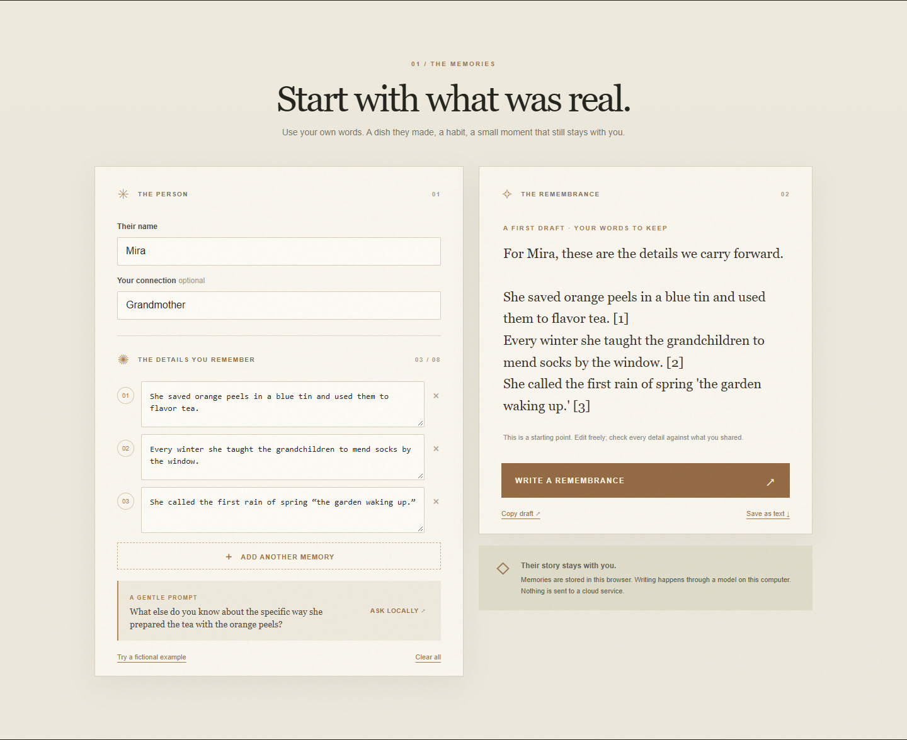
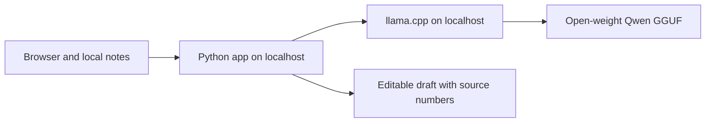

<!-- Before publishing: upload demo-workspace.png and demo.webm to DEV, replace local media paths with uploaded URLs, add the public repository URL, and optionally add a DevRelay agent-session link. -->

*This is a submission for the [Hacktoberfest Open-Source AI Challenge Week 4: Ghost in the Machine](https://dev.to/challenges/hacktoberfest-week4-2026-10-26).*

## What I Built

The first version of my remembrance writer sounded beautiful. It was also wrong.

I gave a local model three notes about a fictional grandmother named Mira: she saved orange peels in a blue tin for tea, taught the grandchildren to mend socks by a window, and had a name for the first spring rain. The model returned a warm paragraph, but it invented the smell of her kitchen and assigned citations `[4]` and `[5]` to facts I had never supplied. Three notes had become five sources.

That failure shaped **Lantern Archive**. It is a private writing space for the concrete details we remember about someone. The AI helps ask for one more story and shapes a first draft, but the person using it stays in control of the facts and the final words. It does not pretend to speak as someone who has died.

You enter a name and up to eight small memories. **Ask locally** suggests a gentle oral-history question based on what you wrote. **Write a remembrance** turns each note into one sentence, with a source number that points back to the original note. You can edit the draft in place, copy it, or save it as a text file.

## Demo

<!-- Replace the image path with an uploaded DEV image URL before publishing. -->

For the fictional Mira example, the local model asked: “What else do you know about the specific way she prepared the tea with the orange peels?” Its draft kept the blue tin, the mending by the window, and her phrase about the rain, each marked `[1]`, `[2]`, or `[3]`.

<!-- Upload demo.webm and embed its DEV-hosted URL here before publishing. -->

No login is needed. To try it, follow the [README setup instructions](REPLACE_WITH_PUBLIC_REPOSITORY_URL), start the app, open `http://127.0.0.1:8765`, and click **Try a fictional example**.

## Code

The [MIT-licensed source and setup guide](REPLACE_WITH_PUBLIC_REPOSITORY_URL) include the Python server, frontend, and model download steps. The model weights are downloaded separately under their own license.

## How I Built It

The frontend is plain HTML, CSS, and JavaScript. A small Python standard-library server serves the page and starts `llama-server`, the HTTP runtime from [llama.cpp](https://github.com/ggml-org/llama.cpp). The model is a Q4_K_M GGUF conversion of [Qwen3.5-4B](https://huggingface.co/Qwen/Qwen3.5-4B), with weights downloaded once from [bartowski's conversion](https://huggingface.co/bartowski/Qwen_Qwen3.5-4B-GGUF). Both model repositories identify the weights as Apache 2.0 licensed.

The debugging change mattered more than a fancier prompt. I switched to llama.cpp's schema-constrained JSON output and ask for exactly one sentence per note. The application validates the number of sentences and adds source numbers itself. The model can still change a nuance, so the UI asks the user to verify every sentence. The citations are review aids, not proof of truth.

Both servers bind to `127.0.0.1`. The Python app gives its llama.cpp process a fresh API key and disables the model server's separate web UI. Names and notes stay in the browser's `localStorage`; the Python app does not persist them. The draft is not automatically saved, so you choose when to copy or download it.

## Why Does Open Innovation Matter?

The open pieces make the core experience possible without sending intimate stories to a hosted AI service. Once llama.cpp and the model are downloaded, the app runs offline. There is no per-request bill, no account, and no dependency on a provider retaining this feature. The prompt, output constraints, and model can all be inspected and changed by someone using the project.

That is a concrete advantage over using a closed API for this particular task: a family's notes can stay on their own computer. I did not run a quality benchmark against closed models, and a larger hosted model might write more gracefully. For a remembrance, local control and the ability to inspect the behavior were the trade I wanted to make.

## What Is Next

I would like to add a simple offline backup format for notes and test the question prompts with real oral-history volunteers before calling this ready for sensitive use. Today it is a working prototype, with an MIT-licensed codebase and no bundled model weights.

<!-- Optional template section: My Agent Session. Add a DevRelay link if you save this session. -->
