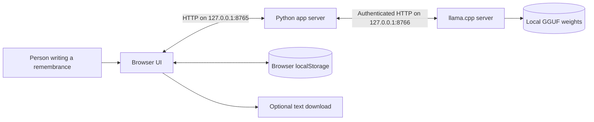
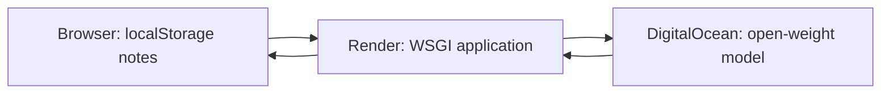

# Lantern Archive — High-Level Design

## 1. Purpose and scope

Lantern Archive helps a person collect concrete memories, get one follow-up question, and turn the notes into an editable remembrance. It runs on one computer. After the llama.cpp runtime and GGUF weights are downloaded, normal use does not require internet access.

This design describes the implemented prototype. It has no Docker container, public deployment, account system, remote database, or cloud inference service. The app is started and stopped by the person using it.

## 2. System context

**Deployment boundary:** The browser, Python process, llama.cpp process, browser storage, and model weights are all on the same machine. Both HTTP listeners bind to `127.0.0.1`. The model weights are supplied through `--model`; they are not part of the project archive.

## 3. Major components

| Component | Responsibility | State it owns |
| --- | --- | --- |
| Browser UI (`static/`) | Capture notes, show model readiness, display and edit output, copy/download text | Name, relationship, and up to eight notes in `localStorage`; current draft in page memory |
| Python app (`app.py`) | Serve static files, validate requests, build prompts, check model output, assign source numbers, manage the model process | Ephemeral API key and process handle; no memory database |
| llama.cpp server | Load the local GGUF and generate structured responses | Model in RAM while running |
| GGUF model file | Supply open-weight language generation | Local disk file, downloaded separately |

## 4. Primary flows

1. **Startup:** The user launches `app.py` with a local GGUF path. Python starts `llama-server`, then serves the UI. The UI polls model health every three seconds and enables model actions when ready.
2. **Collect:** The user types a name, optional relationship, and notes. The browser saves these fields in `localStorage` on every change.
3. **Ask:** The browser sends the notes to `/api/question`. Python asks the model for one neutral, open-ended question and returns it to the page.
4. **Draft:** The browser sends the same notes to `/api/generate`. Python asks for one sentence per note using a JSON schema, validates the count, and adds `[1]`, `[2]`, etc. itself. The browser displays the editable draft.
5. **Keep or clear:** The user may copy or download the draft. Clearing removes the stored name and notes for this browser origin. The draft is not automatically persisted.

## 5. Design principles and trade-offs

- **Local control:** Notes are sent only from the browser to the loopback Python server and its loopback model server. This avoids routine upload to a hosted inference provider.
- **Traceable output:** Each generated sentence maps to one input note by position. The application assigns source numbers so the model cannot invent citation IDs.
- **Human authorship:** The output is editable and explicitly framed as a first draft. Structural constraints do not guarantee factual accuracy; the user must review each line.
- **Small operational footprint:** The web server uses Python's standard library. llama.cpp is an external runtime, and the model is a separate download of about 3 GB for the tested quantization.
- **Single-machine operation:** Fixed loopback ports make setup simple, but prevent concurrent instances on the same ports and remote access by design.

## 6. Nonfunctional properties

| Area | Implemented behavior |
| --- | --- |
| Privacy | No application database or cloud API; browser notes remain in `localStorage`; model API requires an ephemeral key |
| Availability | Runs while both local processes run; UI reports model readiness and process failure |
| Offline use | Supported after installing llama.cpp and downloading the GGUF |
| Performance | Inference is serialized with a lock; latency depends on model and machine (a three-note sample took about 16 seconds on the development laptop) |
| Portability | Python standard library frontend/backend code; llama.cpp and a compatible GGUF are required on the target platform |

## 7. Known limits

The prototype supports English, has no automatic backup or account sync, and does not save generated drafts unless the user copies or downloads them. Browser storage is local but not encrypted. A model can still change a nuance or add unsupported content inside a sentence. See [LLD.md](LLD.md) for the exact contracts and failure behavior.
# Optional hosted demo

The `hosted.py` WSGI entry point serves the same frontend through Gunicorn on
Render Free. It calls DigitalOcean Serverless Inference over HTTPS using a
server-side Model Access Key. `app.py` remains the offline entry point.

The hosted page discloses the cloud processing before submission. No app
database is required. See [deployment instructions](DEPLOYMENT.md) for
environment variables, request limits, free-tier behavior, and shutdown.
