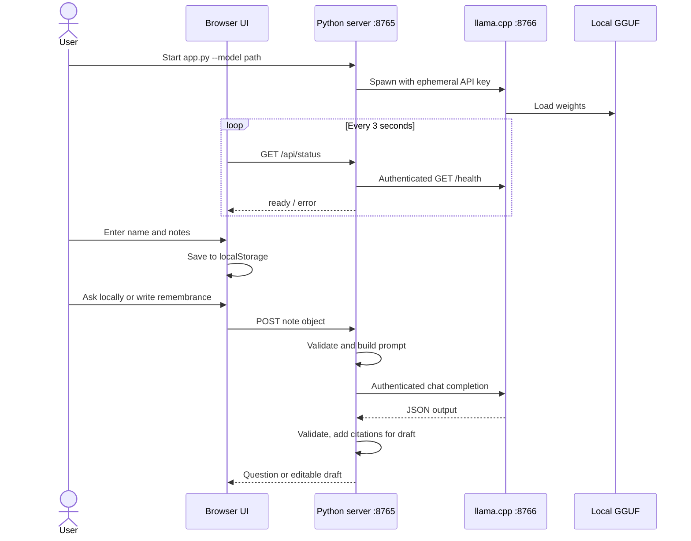

# Lantern Archive — Low-Level Design

## 1. Runtime topology and files

| File | Role |
| --- | --- |
| `app.py` | CLI, model-process management, HTTP routing, validation, prompting, response parsing |
| `static/index.html` | Accessible page structure and controls |
| `static/style.css` | Responsive visual layout, with no remote font dependency |
| `static/app.js` | Browser state, local persistence, API requests, editing/export actions |

`app.py` starts a `ThreadingHTTPServer` at `127.0.0.1:8765` and a `llama-server` child process at `127.0.0.1:8766`. The latter loads the file passed with `--model`. The backend uses `urllib.request` to call the child's OpenAI-style chat completion endpoint.

## 2. Startup and shutdown

1. Parse `--model` and optional `--llama-server`. Reject a missing model file or executable.
2. Generate a random API key with `secrets.token_urlsafe(32)` for this run.
3. Start `llama-server` with the model path, alias `lantern`, 4,096 context size, four CPU threads, zero GPU layers, loopback host, port 8766, the API key, `--no-webui`, and `enable_thinking=false` chat-template arguments.
4. Write model diagnostics to `lantern-llama-<pid>.log` in the operating system's temporary directory. Start the Python web server on port 8765.
5. On Ctrl+C, close the Python server, terminate the child, wait up to five seconds, then kill it if needed.

The UI calls `GET /api/status` every three seconds. `model_ready()` sends an authenticated request to llama.cpp's `/health` with a one-second timeout. The status response also reports when the child process has exited.

## 3. Browser data model

```json
{
  "name": "Mira",
  "relationship": "Grandmother",
  "memories": [
    "She saved orange peels in a blue tin and used them to flavor tea."
  ]
}
```

The browser stores this object under `lantern-archive-v1` in `localStorage`. It initializes with two blank memory fields, caps the UI at eight fields, and reloads saved fields after refresh. The generated question and draft exist only in the current page session. The editable draft is not written to `localStorage` or to the Python server.

## 4. HTTP contract

| Endpoint | Request | Success | Main errors |
| --- | --- | --- | --- |
| `GET /`, `/style.css`, `/app.js` | None | Static page/script/style | `403` wrong Host; `404` unknown path |
| `GET /api/status` | None | `{"ready": true, "local_only": true, "error": null}` | `403` wrong Host |
| `POST /api/question` | JSON note object | `{"question": "..."}` | `400` invalid input; `503` model not ready; `502` model failure; `403` wrong Host/Origin |
| `POST /api/generate` | JSON note object | `{"draft": "...", "model": "Qwen3.5-4B / llama.cpp", "source_count": 3}` | Same error classes as `/api/question` |

The backend permits Host values `127.0.0.1:8765` and `localhost:8765`. For POST, a supplied Origin must be one of those two local HTTP origins. POST bodies must have a `Content-Length` from 1 to 10,000 bytes. Both model endpoints require a nonblank name and at least one nonblank memory. The backend truncates the name and relationship to 80 characters, keeps the first eight memories, truncates each to 600 characters, and drops blank memories. Client-side limits mirror these rules.

The handler sets `Cache-Control: no-store`, `X-Content-Type-Options: nosniff`, and a Content Security Policy restricted to same-origin scripts, styles, and connections. Requests to the model server carry the ephemeral bearer token; browsers do not receive that token.

## 5. Model requests and output checks

The shared `complete()` function sends a nonstreaming `POST /v1/chat/completions` to llama.cpp with alias `lantern`, the selected messages, a JSON output schema, and a 240-second timeout. A `threading.Lock` serializes model requests, while the HTTP server remains threaded for status and page requests. Any `<think>...</think>` span is removed before parsing the model's content.

### Follow-up question

`ask_question()` requests a JSON object containing one `question` string. Its system prompt calls for a short, open-ended question grounded in the notes, without assuming the listener witnessed an event. The backend parses the object, rejects an empty value, and caps the returned string at 300 characters.

### Remembrance draft

`generate()` asks for JSON shaped as:

```json
{"lines": ["One sentence for note 1.", "One sentence for note 2."]}
```

The schema fixes the array length to the number of nonblank input notes. The backend also checks that the parsed `lines` value is a list of that length and that each item is a nonblank string. It then constructs the draft:

```text
For Mira, these are the details we carry forward.

<line 1> [1]
<line 2> [2]
```

Source numbers are generated from array positions, never from model-supplied citations. The check verifies structure and count only; it does not prove that every sentence is factually supported.

## 6. Request sequence



## 7. UI behavior and export

The sample button loads fictional notes about Mira. `clearAll()` uses a confirmation dialog, replaces the stored name and notes with blank fields, and clears the visible output. Copy uses `navigator.clipboard.writeText`. Save uses a browser `Blob` and an object URL to download `remembrance-<name>.txt` in UTF-8. The text filename sanitizes the name to lowercase ASCII letters, digits, and hyphens.

The browser displays a model-loading state until `/api/status` reports ready. It disables generation when unavailable, shows API errors, and lets the user edit the resulting text directly in a `contenteditable` element.

## 8. Error handling and implementation limits

- Invalid JSON, empty required fields, or an oversized body return `400`.
- Requests from a nonlocal Host or supplied nonlocal Origin return `403`.
- An unavailable/loading model returns `503`; completion, parsing, and malformed model-output failures return `502`.
- Output schemas constrain shape, but not factual meaning. A person should compare each line with its note before sharing it.
- Model calls are serialized; concurrent requests queue behind the lock. The UI does not provide cancellation or streaming.
- Ports are fixed. The success response's model label names the tested Qwen model even if `--model` points to another compatible GGUF.
- Browser `localStorage` is unencrypted and tied to the browser profile and origin. No automatic draft persistence or backup exists.
